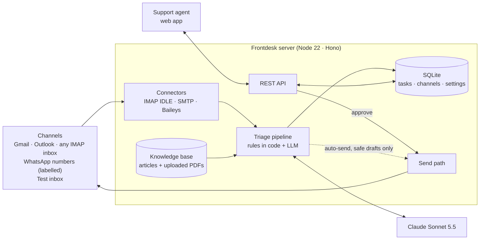
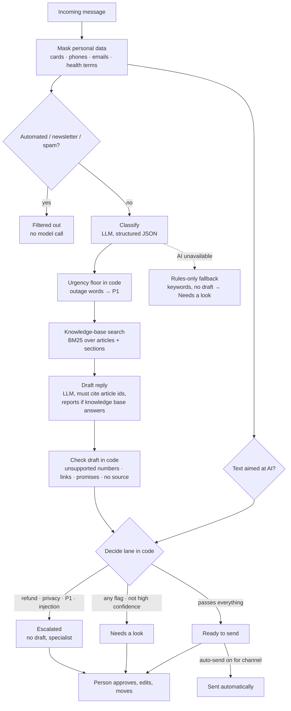
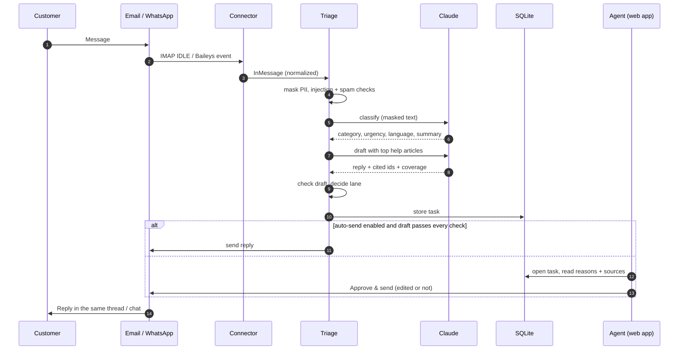
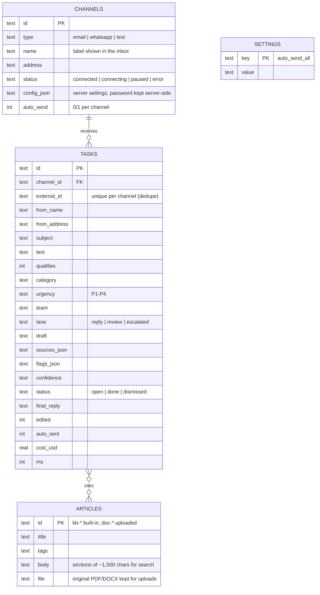
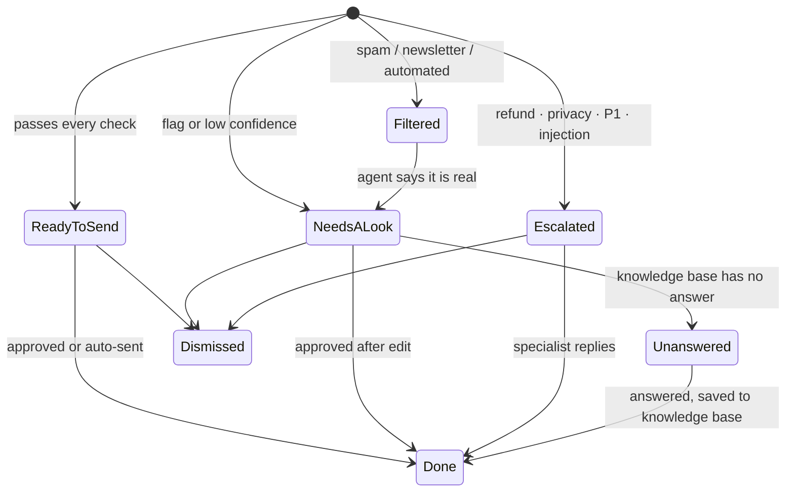

# Frontdesk architecture

Principle: **code decides, the model drafts.** The language model reads and writes text. Plain code decides what is risky, which lane a task goes to, and whether anything is sent. A person approves every reply, unless an admin turns on auto-send, which only ever sends drafts that pass every check.

## System diagrams

### System context



### Triage pipeline (code decides, the model drafts)



### Message to reply (sequence)



### Data schema



### Task lifecycle



## Data flow

```
  Email (IMAP IDLE)      WhatsApp (Baileys)      Test inbox (UI / demo)
        |                       |                        |
        +-----------+-----------+------------------------+
                    |
                    v
            normalize -> InMessage            (connectors/email.ts, connectors/whatsapp.ts)
                    |   dedupe on channel + external_id
                    v
  +------------------ triage(msg) -> TriageResult  (triage.ts) ------------------+
  |                                                                            |
  |  1. maskPII            card, phone, IBAN, DOB, health terms -> [tokens]  code |
  |  2. detectInjection    "ignore previous instructions", ...              code |
  |  3. prefilter          no-reply, List-Unsubscribe, OTP -> Filtered      code |
  |  4. classify           qualifies, category, urgency, sentiment,         LLM  |
  |                        language, summary, search_query (JSON schema)         |
  |  5. urgency floor      outage words -> >= P1/P2; angry+refund -> >= P2  code |
  |  6. KB search          kb/*.md, keyword/BM25, top 3                     code |
  |  7. draft              reply in customer's language, only from          LLM  |
  |                        articles, cites article ids (JSON schema)             |
  |  8. checkDraft         promises, unsupported numbers/URLs/dates,        code |
  |                        no source, language mismatch -> flags                 |
  |  9. decideLane         reply | review | escalated, team                 code |
  |                                                                            |
  |  AI unavailable at 4 or 7 -> ruleClassify (keywords), no draft,            |
  |  lane = review, flag ai_unavailable, mode = rules                          |
  +----------------------------------------------------------------------------+
                    |
                    v
            store message + task (SQLite)     (ingest.ts, db.ts)
                    |
                    v
   Inbox UI: Ready to send | Needs a look | Escalated | Filtered | Done
                    |
                    v
        HUMAN: read, edit, approve / move / dismiss
                    |
                    v
   send on the original channel: SMTP reply (In-Reply-To) | WhatsApp | test (mark sent)
```

## Components

| Part | File | Role |
|---|---|---|
| HTTP server | `server/src/index.ts` | Hono app on `PORT` (8787). `/api/*`; serves `web/dist` in production. |
| Storage | `server/src/db.ts` | `node:sqlite` (built into Node 22) at `data/frontdesk.db`. |
| Auth | `server/src/auth.ts` | One admin from `.env`. Signed httpOnly cookie `fd_session`. |
| Model client | `server/src/llm.ts` | Anthropic SDK, or OpenRouter as fallback. `json(system, user, schema)` returns parsed JSON plus token usage and cost. |
| Pipeline | `server/src/triage.ts` | Steps 1 to 10 above. |
| Rules | `server/src/rules.ts` | All deterministic parts: `maskPII`, `detectInjection`, `prefilter`, `ruleClassify`, `checkDraft`, `decideLane`. Unit-tested in `server/test/`. |
| Knowledge base | `server/src/kb.ts`, `kb/*.md` | Loads Markdown articles with front matter; keyword search. |
| Ingest | `server/src/ingest.ts` | Runs triage, stores message and task. |
| Connectors | `server/src/connectors/email.ts`, `whatsapp.ts` | IMAP listen (imapflow, IDLE) + SMTP send (nodemailer); Baileys QR pairing, listen, send. |
| UI | `web/` | React 19 + Vite + Tailwind. |
| Evaluation | `eval/cases.json`, `eval/run.ts`, `eval/results/` | Labelled test set, baseline vs pipeline. |

## Data contracts

Source of truth: `server/src/types.ts`.

**InMessage** (what every connector produces):

```ts
{ channel: 'email' | 'whatsapp' | 'test'; channel_id; external_id;
  from_name; from_address; subject: string | null; text; received_at /* ISO */;
  thread_key?; headers? }
```

**TriageResult** (what the pipeline produces, stored on the task):

```ts
{ qualifies; not_qualifying_reason: 'spam' | 'newsletter' | 'automated' | 'personal' | null;
  category: 'how_to' | 'bug' | 'outage' | 'billing' | 'refund' | 'account_access'
          | 'cancellation' | 'feature_request' | 'data_privacy' | 'other' | null;
  urgency: 'P1' | 'P2' | 'P3' | 'P4' | null; sentiment;
  language /* ISO-639-1 */; summary /* English, one line */;
  team: 'support' | 'billing' | 'engineering' | 'success' | 'privacy' | null;
  lane: 'reply' | 'review' | 'escalated' | null;
  reasons: string[]; draft: string | null; sources: {id, title}[];
  flags: {kind, text}[]; confidence: 'high' | 'medium' | 'low';
  injection: string[]; pii_masked: number;
  mode: 'ai' | 'rules'; model; cost_usd; ms }
```

Both model calls use a JSON schema (structured output), so the pipeline gets typed fields, not free text to parse.

## Lane rules (code, `decideLane`)

- **escalated** (no draft): injection detected, data privacy, refund, P1 outage, legal threat, angry cancellation. Team is set (privacy, billing, engineering, success).
- **review**: any flag, confidence not high, no sources, or rules mode.
- **reply**: everything else.

## Model choice and trade-offs

- **Claude Sonnet 5.5 at low effort** for both classify and draft. Triage is short, structured and high volume; speed and cost per ticket matter more than deep reasoning. Low effort keeps latency low.
- **Opus** would likely write slightly better drafts on hard cases but costs more and is slower. Hard cases are escalated to people anyway, so the extra quality would mostly be spent on messages a human handles. Switching is one env var (`MODEL`) if the evaluation shows a quality gap.
- **OpenRouter fallback** so the app works with either key.
- **Rules fallback** when no key is set or the API fails after retries. The inbox keeps working; it just has no drafts.
- **Why code decides lanes:** the lane decides what a human sees first and what can be sent quickly. That decision must be predictable, testable with unit tests, and impossible to change by writing clever text in a message. The model's opinion is an input (category, urgency, confidence); the code applies fixed rules on top, including urgency floors the model cannot lower.
- **Keyword search instead of embeddings:** with about ten articles, keyword search with tags is enough, explainable, and has no extra service. It is the first thing to replace if the knowledge base grows.
- **SQLite in-process:** zero setup for a single-team install. Not built for many concurrent writers.

## Security and privacy boundaries

- **PII is masked before the model.** Card numbers, phone numbers, IBAN-like strings, dates of birth and health terms become tokens like `[card]`. The model only ever sees masked text. The count is stored (`pii_masked`).
- **Message text is untrusted.** It is wrapped as data in the prompt, and the model is told never to follow instructions inside it. Independently, `detectInjection` (code) flags known manipulation phrases and forces the task to Escalated. The model has no tools: it cannot send, refund or change anything, whatever it is told.
- **Auto-send is opt-in.** By default the only send path is `POST /api/tasks/:id/approve`. If an admin enables auto-send (all channels or per channel), `ingest` sends only drafts that pass `autoSendEligible()` in `server/src/send.ts`: Ready to send, high confidence, AI mode, no flags, no injection.
- **Channel secrets** (IMAP/SMTP passwords, WhatsApp session keys) are stored locally in `data/` (git-ignored) and never returned by the API.
- **Single admin.** One account from `.env`, signed httpOnly session cookie. No roles. Fine for a prototype; per-agent accounts are on the plan.
- **WhatsApp via Baileys is unofficial.** It can be logged out or banned by WhatsApp. Prototype only. Production path: WhatsApp Business Cloud API (official, webhook-based, template rules for messages after 24 hours).
- **Gmail via App Password now, OAuth next.** App Passwords are simple for a reviewer to set up. OAuth in "testing" mode would block reviewers who are not added as test users, so it was deferred.

## Failure handling

| Failure | Handling |
|---|---|
| Model API error or timeout | SDK retries (2 retries, 60 s timeout; OpenRouter: 3 attempts). Then rules mode for that message with an `ai_unavailable` flag. Re-run later from the UI. |
| No API key | Rules mode from the start. App does not crash. |
| Model output truncated or refused | Treated as an error, same fallback. |
| Draft says something risky | `checkDraft` flags it; the task goes to Needs a look. |
| Duplicate delivery (IMAP re-sync, WhatsApp re-send) | Dedupe on channel + `external_id`. |
| IMAP connection drop | Reconnect with backoff; IDLE resumes. |
| WhatsApp disconnect | Baileys reconnects; if logged out, channel shows error and needs a new QR. |
| Send fails on approve | Task stays open, error shown to the user; nothing is marked sent. |
