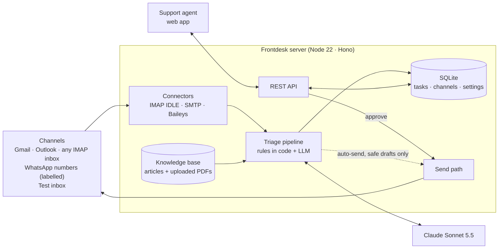
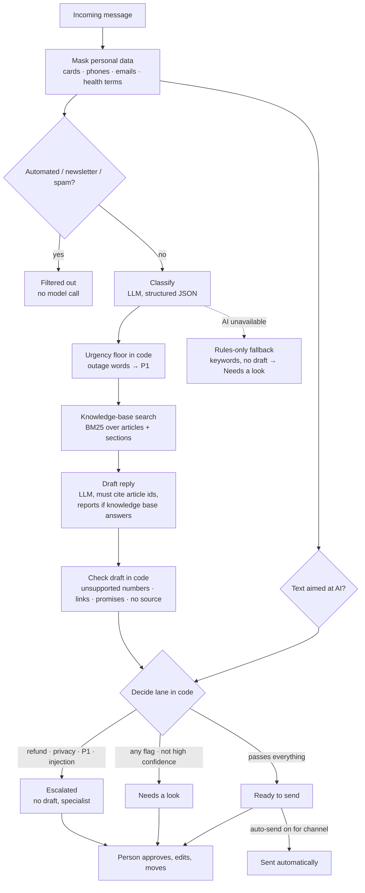

# Case study: Frontdesk, a human-approved AI triage desk for customer support

**One line:** a small support team gets customer messages on email and WhatsApp. Frontdesk filters the noise, sorts the rest by topic and urgency, drafts knowledge-base-based replies, and leaves every send to a person.

## 1. User and problem

**User:** a support agent (and their team lead) at a small B2B SaaS company, two to five people handling all inbound customer messages across email and WhatsApp.

**Why this problem:** we run into it constantly on the WonderCall team. Customer messages arrive across several inboxes and WhatsApp, urgent issues get buried under routine questions and noise, and every reply depends on someone remembering the right knowledge-base answer. Frontdesk is built for that team's workflow.

To keep customer data private, the demo and the evaluation use a fictional business, Slotwise (appointment-booking software for clinics and salons: booking page, reminders, deposits, staff calendars, calendar sync), with a synthetic knowledge base and test messages.

**Problem:** every message, whether it is a newsletter, a how-to question or a full outage, arrives in the same inboxes, in the order it was sent. The agent has to read each one, decide if it is real, work out how urgent it is, search the knowledge base, write a reply, and route anything risky. Two things go wrong:

- **Urgent messages wait behind routine ones.** "Patients can't book" may sit under twenty password questions.
- **Fast replies can be unsafe.** Copying a chatbot answer can promise a refund, invent a price, or follow instructions planted in a message.

## 2. Existing workflow and bottleneck

| Step | Today | Tool | Who judges | Typical problem |
|---|---|---|---|---|
| **Trigger** | A customer emails or sends a WhatsApp message. | Gmail, WhatsApp on a phone | — | Two places to watch; WhatsApp often on one person's phone. |
| **Input** | Free text, any language, sometimes with card numbers or health details. | — | — | Noise (newsletters, automatic emails, spam) mixed in. |
| **Judgment** | Is it real? What is it about? How urgent? Who owns it? | Agent's head | Agent | Inconsistent; outages written as calm questions get missed. |
| **Tool** | Search the knowledge base; sometimes paste into ChatGPT. | Knowledge base, ChatGPT | Agent | Slow search; chatbot answers may invent facts or promise money. |
| **Approval** | Agent decides to send; refunds and privacy go to a lead. | — | Agent / lead | No structured signal of what is risky. |
| **Output** | Reply on the same channel. | Gmail, WhatsApp | — | — |
| **Exception** | Outage, refund, GDPR request, legal threat, abuse. | Slack / hallway | Lead, engineering, privacy | Found late, or by the customer escalating. |

**Bottleneck:** the read, decide, search, write loop for every message. It is repeated for every message and depends on one person's attention.

**Baseline time:** **assumed 4–6 minutes per ticket** for read + search knowledge base + write + route. This is an assumption, to be measured in week 1. It is not a measurement.

## 3. Scope decisions and non-goals

**In scope:** two real channels (IMAP/SMTP email and WhatsApp), a test channel, filtering, classification, urgency, routing, grounded drafts, draft checks, a three-lane human queue, approve-to-send on the original channel, a labelled evaluation against a baseline.

**Key decisions:**

- **Auto-send is off by default.** Even "Ready to send" needs a click unless an admin turns auto-send on, and then only drafts that pass every check go out unattended. The cost of one wrong refund promise or leaked detail is higher than the time saved by auto-sending.
- **Code decides lanes, the model drafts.** Escalation rules are plain code, unit-tested, and cannot be changed by message text.
- **Risky topics get no draft.** Refunds, privacy, outages, legal threats and injection attempts go to a person with reasons, not a suggested reply.
- **Email via IMAP, not POP3.** POP3 cannot listen for new mail and can delete mail from the server.
- **Gmail App Password, not OAuth, for now.** OAuth in Google's "testing" mode would block reviewers who are not on the test-user list.
- **WhatsApp via Baileys for the demo.** It works with a QR scan and no business verification. It is unofficial, and this is stated everywhere it matters.

**How the problem was chosen:** it is the bottleneck the WonderCall team hits most often. It also fits a five-day build well, because it is recurring, it has an obvious human approval point, it involves real integrations (mailboxes and WhatsApp), and it can be measured against a simple baseline with labelled messages.

**Non-goals:**

- Auto-sending anything risky: escalated, flagged or low-confidence messages always wait for a person.
- Replacing a ticketing system (no SLAs, assignment, or full conversation history).
- Voice and phone support.
- Gmail OAuth (next iteration).
- Multi-user accounts and roles.
- Analytics beyond basic counts, cost and edit rate.
- Taking actions in other systems (refunds, cancellations, account changes).

## 4. Architecture and major trade-offs

**System overview**



**Triage pipeline**



Data schema, sequence and task lifecycle diagrams: docs/ARCHITECTURE.md.


```
email / WhatsApp / test -> normalize -> mask PII -> injection check -> prefilter
  -> classify (LLM, JSON) -> urgency floor (code) -> knowledge-base search
  -> draft (LLM, JSON, cites articles) -> check draft (code) -> decide lane (code)
  -> queue -> human approve -> send on original channel
```

Node.js 22, Hono, SQLite (built into Node), React. Claude Sonnet 5.5 at low effort for classify and draft. Full detail: [ARCHITECTURE.md](ARCHITECTURE.md).

| Trade-off | Choice | Why | Cost of the choice |
|---|---|---|---|
| Who decides risk | Code | Predictable, testable, not open to prompt injection | Rules miss cases the model might catch; mitigated by "Needs a look" for any doubt |
| Model | Sonnet 5.5, low effort | Fast and cheap for short structured tasks | Slightly weaker drafts than Opus on hard cases (which are escalated anyway) |
| AI down | Rules mode | Inbox never stops working | No drafts until the AI is back |
| Retrieval | Keyword + tags | ~10 articles; explainable; no extra service | Misses synonyms; replace if the knowledge base grows |
| Storage | SQLite file | Zero setup | One server, few concurrent writers |
| WhatsApp | Baileys | Demo in minutes | Unofficial; ban risk; not for production |
| Privacy | Mask PII before the model | The model never sees card numbers or health details | Masking can hide context the draft needed |

## 5. Work delegated to AI vs judgment retained by humans

| Delegated to the model | Kept in code | Kept with people |
|---|---|---|
| Understanding free text in any language | PII masking | Approving every reply |
| Topic, urgency, sentiment, summary | Injection detection | Refunds, credits, cancellations |
| Search query for the knowledge base | Filtering automated mail | Privacy and deletion requests |
| Drafting a reply from articles | Urgency floors for outages | Outage communication |
| Saying how confident it is | Draft checks (promises, unsupported facts) | Editing tone and content |
| | Lane and team decision | Changing knowledge-base content and rules |

## 6. Failures, changes, results, limitations

**Failure modes designed against** (expected weaknesses of a single-prompt approach; whether the design actually fixes them is what the evaluation checks):

- A single prompt can treat instructions inside a message as instructions. Addressed by code-level injection detection plus escalation, and by wrapping message text as data.
- A calm-sounding outage report can be classified as a how-to question. Addressed by an urgency floor in code that the model cannot lower.
- Drafts can contain plausible but invented prices or links. Addressed by `checkDraft`, which flags any number, URL or date not present in the cited articles or the message.

**Evaluation failures** (details in [EVALUATION.md](EVALUATION.md)): (1) a routing rule in code sent every bug to engineering, so team accuracy was 68%, worse than the baseline; fixed to 100%. (2) Escalated messages showed no help articles; fixed, 79% → 100%. (3) The lane depends on the model's self-reported confidence, which flipped two cases between identical runs; left as is because it fails safe, replacement planned.

**Results** (24 labelled messages, Claude Sonnet 5.5, one run each):

| Metric | Baseline (one prompt + docs) | Frontdesk (final) |
|---|---|---|
| Real request vs noise | 23/24 | 24/24 |
| Category correct | 21/22 | 22/22 |
| Team correct | 20/22 | 22/22 |
| Escalation correct | 21/24 | 23/24 |
| P1 caught / injection caught | 1/1 · 1/1 | 1/1 · 1/1 |
| Replies with promises or forbidden text | 0 | 0 |
| Right help article attached | not shown | 19/19 |
| Urgency exact | 18/22 | 18/22 (not better) |
| Lane correct | n/a | 19/20 |
| Latency p50 | 3.7 s | 5.6 s |
| Cost per message | $0.015 | $0.010 |

Where it did not improve: urgency accuracy only matches the baseline, and it is about 1.5 s slower per message (two model calls instead of one).

**Limitations:**

- Not yet piloted with the WonderCall support team; that is the first step of the next iteration. The evaluation uses synthetic messages to keep customer data private.
- Small test set (24 cases) written by the author, so labels reflect the author's judgment.
- WhatsApp connection is unofficial.
- Single admin account.
- Keyword retrieval.
- The baseline time per ticket is an assumption.

## 7. Metrics to track in the first two weeks after deployment

**Adoption**

- Share of inbound customer messages handled in Frontdesk (vs answered directly in Gmail or on the phone).
- Approvals per day, per agent.
- Time to first response (message received to reply sent), median and p90, compared with the week before.
- P1 time to escalate (message received to a person acting on an Escalated P1).

**Quality**

- Edit rate: share of approved replies edited before sending, by category. Falling over time means drafts are improving.
- Reverted / complaint rate: replies followed by a customer complaint or a correction.
- Misroute rate: tasks moved to a different lane or team by an agent.
- Unsafe-draft rate: drafts with a promise or unsupported-fact flag; and any unsafe reply that was actually sent (target: zero).
- Filtered false positives: real customer messages found in Filtered.

**Cost**

- Model cost per ticket and per day; share of messages handled in rules mode.

**Week 1 also measures the baseline:** time a sample of tickets handled the old way, to replace the 4–6 minute assumption with a real number.

## 8. Next two-week iteration plan

| Week | Item | Why |
|---|---|---|
| 1 | Gmail OAuth (verified app) | Remove App Passwords; work with Workspace accounts that block them. |
| 1 | Slack alert for P1 and Escalated | Outages should not wait for someone to open the inbox. |
| 1 | Measure the real manual baseline | Replace the assumed 4–6 minutes. |
| 2 | Official WhatsApp Business Cloud API | Remove the ban risk; production-safe. |
| 2 | Ticketing integration (e.g. Zendesk, Freshdesk, HubSpot) | Create or update tickets instead of being a separate inbox. |
| 2 | Per-agent accounts | Know who approved what; basic roles (agent, lead). |
| 2 | Learn from edits | Collect edited drafts; turn repeated edits into knowledge-base updates and new eval cases. |
